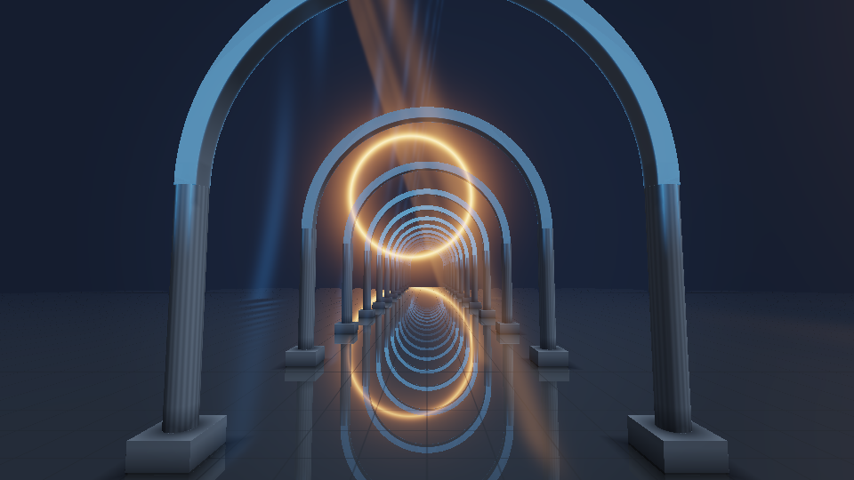
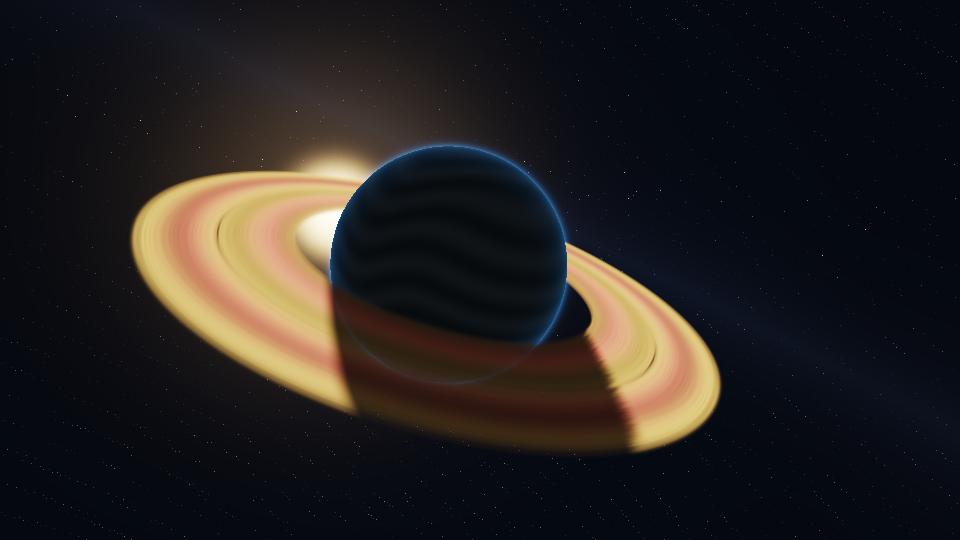

# Two cinematic studies

These are self-contained CUDA performances with 48-second looping cameras, four
harmonic movements, and synthesized stereo scores. They borrow the demo scene's
love of impossible architecture, cosmic scale, reflections, and musical progression.
No external textures, models, samples, or persistent simulation state are needed.

```bash
./build/dev/cudalab --demo last-cathedral
./build/dev/cudalab --demo eventide
```

Move horizontally to steer and vertically to raise the camera. Hold the primary
button to strengthen the cathedral's shafts or Eventide's ring illumination.
The preview's timeline supports arbitrary seeking; its Audio toggle controls sound.
Quality changes sample budgets, preserving the same scene and rendering technique.

## The Last Cathedral



A processional flight through eight bays of an endless nave. Fluted columns and cyan
vault edges frame an amber halo, reflected in an obsidian tile floor. The camera rises
and gently banks before returning to its opening position relative to the architecture.
Amber and blue shafts occupy the space between the ribs. A minor-key pad develops
into a plucked arpeggio and a restrained synthesized kick, then recedes.

Each CUDA thread sphere-traces a repeated signed-distance field, estimates the surface
normal and local occlusion, and optionally traces one floor-reflection ray. A bounded
integration adds shafts along the visible ray. This is a stylized renderer: the shafts
are authored density fields, not a physically based multiple-scattering simulation.

At quality 2, the caps are 176 primary steps, 128 reflection steps, and 32 shaft samples.
Marches terminate early on surfaces or at 85 world units. Signed squares use multiplication:
CUDA fast-math `powf` must not be given a negative base, even for an integer exponent.

## Eventide



An orbital camera frames a blue-black planet, amber rings, and a sun moving through
its silhouette. Bands in the atmosphere drift through the light. Ring gaps, a softened
planetary shadow, and the illuminated limb establish depth. The brighter, slower
arpeggio and open suspended chords give this piece a different musical character.

Each lane analytically intersects the planet and bounds the ring slab with a sphere.
Ring density is integrated front-to-back, with the interval clipped to the planet's
first intersection. The far arc disappears behind the planet while the near arc
attenuates it. Atmosphere and solar glare are procedural approximations.

Quality 2 uses 48 ring samples only for rays that intersect the slab. Both pieces
finish in linear light with an ACES-style tone curve, display gamma, and a vignette.

## GPU qualification

Measured on `sparky.local`, Linux, NVIDIA GB10 (SM 12.1), driver 595.84, CUDA Toolkit
13.0.88. The studio live-compiled both entries with NVRTC for `compute_121` and fast
math. Captures above came from the actual SDL offscreen / OpenGL / CUDA interop path,
at 960 × 540, quality 2, centered pointer. No CPU renderer or generated illustration
was used. Both PNGs were captured from this repository's procedural kernels and
are distributed under the repository's MIT license; they contain no third-party assets.

The standalone probe compiles the same source with NVCC, `sm_121`, and fast math.
The following **kernel-only** CUDA-event measurements use time 24, centered pointer,
960 × 540, one warmup, then 30 launches. They exclude interop, presentation, compilation,
and audio; they are not application frame-rate claims.

| Piece | Quality | Min / median / p95 / max (ms) |
|---|---:|---|
| The Last Cathedral | 0 | 0.181 / 0.183 / 0.186 / 0.204 |
| The Last Cathedral | 2 | 0.215 / 0.218 / 0.218 / 0.220 |
| The Last Cathedral | 3 | 0.230 / 0.232 / 0.235 / 0.235 |
| Eventide | 0 | 0.060 / 0.061 / 0.062 / 0.062 |
| Eventide | 2 | 0.097 / 0.099 / 0.101 / 0.103 |
| Eventide | 3 | 0.114 / 0.117 / 0.120 / 0.120 |

Each piece requests **zero persistent state bytes and zero named resources**. At this
resolution, the RGBA output is 2,073,600 bytes; studio PBO/texture allocations and runtime
overhead are additional. The standalone audio test allocates 18,432,000 bytes to check
all 2,304,000 stereo samples of a complete loop at 48 kHz; normal streaming uses small
blocks instead.

Validation also covered:

- All 18 gallery entries passed the studio's compile/render/audio smoke test.
- All 18 completed the five-state interaction probe, including pressed-button states.
- Both cinematic entries were captured at 0, 12, 24, 36, and 47.9 seconds.
- Full-loop audio contained only finite samples. Cathedral peak/RMS: 0.3161/0.0665;
  Eventide: 0.2924/0.0634. Loop-edge delta rounded to zero at four decimal places.
- Independently launched audio at sample offset 576003 matched continuous output exactly.
- Compute Sanitizer memcheck reported zero errors for both render/audio probes,
  including a 1021-sample seek block and a pressed-pointer render.
- Catalog checks passed with assertions enabled, including timeline and allocation contracts.

These checks establish rendering and numerical audio behavior on this GPU. They do not
qualify Windows, other GPU architectures, or speaker playback quality.

## Repeat the checks

On a Linux NVIDIA machine with the project dependencies:

```bash
cmake --preset dev
cmake --build --preset dev
ctest --preset dev
SDL_VIDEODRIVER=offscreen SDL_AUDIO_DRIVER=dummy ./build/dev/cudalab --smoke-test
SDL_VIDEODRIVER=offscreen SDL_AUDIO_DRIVER=dummy ./build/dev/cudalab --interaction-probe /tmp/cudalab-probe
SDL_VIDEODRIVER=offscreen SDL_AUDIO_DRIVER=dummy ./build/dev/cudalab --snapshot last-cathedral 24 /tmp/cathedral.ppm .5 .5 4
SDL_VIDEODRIVER=offscreen SDL_AUDIO_DRIVER=dummy ./build/dev/cudalab --snapshot eventide 0 /tmp/eventide.ppm .5 .5 4
```

The standalone probe needs only NVCC and a CUDA GPU. Substitute the architecture of
your GPU for `sm_121`. It checks nonblank output, times render launches, validates a
complete audio loop, and compares a separately launched, non-block-aligned audio slice.

```bash
nvcc -std=c++20 -arch=sm_121 --use_fast_math -Iinclude -I. \
  '-DDEMO_SOURCE="examples/last-cathedral/last-cathedral.cu"' \
  tests/cinematic_probe.cu -o /tmp/probe-cathedral
/tmp/probe-cathedral /tmp/cathedral.ppm 24 .5 .5 0 2

nvcc -std=c++20 -arch=sm_121 --use_fast_math -Iinclude -I. \
  '-DDEMO_SOURCE="examples/eventide/eventide.cu"' \
  tests/cinematic_probe.cu -o /tmp/probe-eventide
/tmp/probe-eventide /tmp/eventide.ppm 24 .5 .5 0 2
```

The probe accepts `OUTPUT.ppm TIME [MOUSE_X MOUSE_Y BUTTON QUALITY]`. Its timings vary
with clocks, other GPU workloads, camera position, resolution, and quality.
